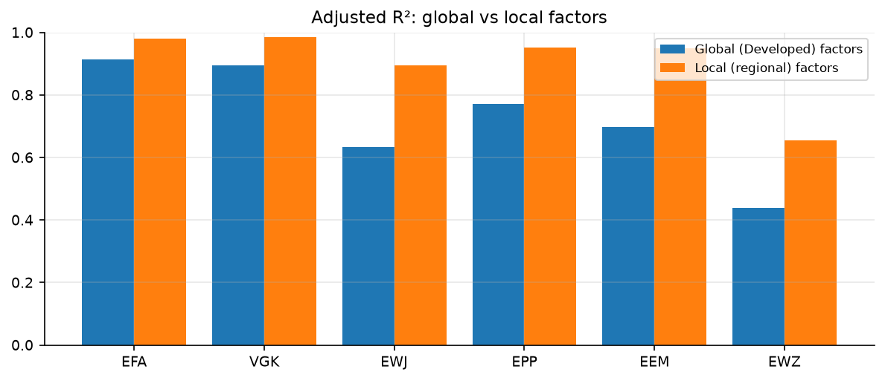
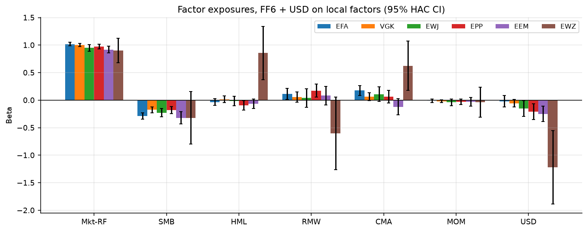

# International Factor Exposure & Return Attribution Lab

Which risks drive the returns of international equity ETFs, and are those risks priced
**globally** or **locally**? This project estimates Fama–French 5-factor + momentum exposures for six
international ETFs, compares global and regional factor models, measures sensitivity to the US
dollar, and tests whether exposures were stable over 2006–2026. A **Russia case study** rebuilds a
foreign investor's return from Moscow Exchange data to measure the ruble's drag and how sanctions
cut Russia off from emerging-market risk pricing.

[](https://colab.research.google.com/github/pautino/intl-factor-lab/blob/main/notebooks/international_factor_lab.ipynb)
Click the badge, then **Runtime → Run all**. The first cell clones this repo and installs dependencies.

---

## Key results (Feb 2006 – Sep 2026, 248 months)

| ETF | Local factor set | Adj. R² global → local | USD beta (t) | Alpha p.a. (t), FF6+USD |
|---|---|---|---|---|
| EFA | Developed ex US | 0.91 → 0.98 | −0.02 (−0.4) | −1.2% (−2.8) |
| VGK | Europe | 0.90 → 0.99 | −0.06 (−1.6) | −0.4% (−1.1) |
| EWJ | Japan | 0.63 → 0.89 | −0.15 (−2.1) | −0.7% (−1.1) |
| EPP | Asia-Pacific ex Japan | 0.77 → 0.95 | −0.21 (−2.8) | −0.7% (−0.9) |
| EEM | Emerging | 0.70 → 0.95 | −0.25 (−3.4) | −0.8% (−0.9) |
| EWZ | Emerging (single country) | 0.44 → 0.65 | −1.22 (−3.6) | −5.8% (−1.4) |

1. **Local beats global (segmentation).** Regional factors explain far more of every ETF's return than
   developed-market "global" factors; the gap is largest for Japan and emerging markets. This
   matches Griffin (2002): country/regional versions of the Fama–French factors price international
   returns better than global ones.
2. **The dollar matters for Asia and EM, not Europe.** Emerging-market equity returns in USD are
   −0.78 correlated with the broad dollar index. Even after removing the part of the dollar move
   carried by the market factor, EEM, EPP, EWJ and especially EWZ fall significantly when the dollar
   strengthens, consistent with the global financial cycle (Rey, 2013). For EFA and VGK the extra
   dollar sensitivity is insignificant.
3. **Brazil's dollar sensitivity increased sharply.** EWZ's residual USD beta moved from −0.46
   (2006–2015) to −2.17 (2016–2026); the Wald test rejects stable exposures (p < 0.001). VGK, EPP
   and EEM also reject stability at 5%; EFA does not.
4. **Size is a built-in sanity check.** SMB is significantly negative for every broad ETF
   (−0.18 to −0.32): MSCI indices hold large and mid caps while French's market includes small caps.
5. **Alpha is mostly cost.** All alphas are negative; only EFA's (−1.2% p.a.) is significant. Expense
   ratios, foreign dividend withholding tax and index mismatch (French's `Developed_ex_US` includes
   Canada; MSCI EAFE does not) explain it. No evidence of skill or mispricing.
6. **Month-end timing reverses, because markets close at different times.** Residual lag-1
   autocorrelation is −0.27 to −0.41 for funds holding Asian/European stocks but only −0.11 for EWZ.
   Direct test: the S&P 500's return on the month's last trading day explains 27–44% of residual
   variance, loading **positively** this month and **negatively** next month (|t| = 5–9), as the
   US-listed ETF prices late US-hours news one month before the local factor does. The loading
   scales with the time-zone gap: ≈0.5 for Asia (closed during the whole NY session), 0.2–0.3 for
   Europe (overlaps the NY morning), insignificant for Brazil. A lagged-market (Dimson) term is
   insignificant (|t| < 1.2), ruling out slow price adjustment. Betas are unaffected; Newey–West
   errors account for the serial dependence.
7. **Quarterly robustness:** adjusted R² improves, but residual lag-1 autocorrelation remains −0.33 to −0.20 across 82 complete quarters (2006Q2–2026Q3). This is expected under finding 6: the closing-time mismatch recurs at every quarter-end, so aggregation dilutes it but cannot remove it (see `reports/tables/quarterly_robustness.csv`).
8. **Currency hedging paid off, mostly because the dollar rose.** Over the 151 months both funds
   exist (Mar 2014 – Sep 2026), hedged HEFA compounded 10.3% a year vs 6.6% for unhedged EFA, with lower
   volatility (11.9% vs 14.4%). The monthly gap HEFA − EFA moves one-for-one with the dollar
   (β = 1.02, t = 16, R² = 0.78): hedging removes the currency loss when the dollar strengthens. Of
   the 3.11% average annual gap (monthly mean ×12), 2.16 points come from the dollar's appreciation over the sample and
   0.95 points are left over (t = 1.2). That remainder has the sign and rough size of hedge carry under
   covered interest parity (US short rates mostly above euro/yen rates), net of costs, but it is not
   statistically significant and no rate data are used to test it. HEFA's 3.2% "alpha" in the
   USD-factor model is not skill: those factors are dollar-denominated, so a hedged fund's dollar
   gains land in the intercept (see `reports/tables/hedged_vs_unhedged.csv`).
9. **Russia: sanctions turned an emerging market into a closed one.** The US-listed Russia ETFs
   (RSX, ERUS) were halted in 2022 and Yahoo has deleted their histories, a live case of
   survivorship bias. Rebuilding a dollar investor's return from the MOEX Russia total-return index
   and the Moscow Exchange USD/RUB rate (validated against MOEX's own RTS conversion, corr 0.999):

   | Period | Adj. R² on EM factors | EM market beta (t) | Oil beta (t) | Return in RUB | Ruble vs USD | Return in USD |
   |---|---|---|---|---|---|---|
   | 2006-02 – 2014-02 | 0.76 | 1.05 (7.1) | 0.19 (2.9) | 5.0% | −3.0% | 1.9% |
   | 2014-03 – 2022-02 | 0.41 | 0.84 (6.9) | 0.08 (1.0) | 13.2% | −11.8% | −0.1% |
   | 2022-04 – 2026-09 | −0.02 | 0.17 (0.5) | 0.05 (0.7) | 5.0% | 0.0% | 5.0% |

   - **Decoupling.** Co-movement with emerging markets fell in steps: after Crimea and the first
     sanctions (2014) and completely after the 2022 invasion, when foreigners were locked out. A
     market that global investors cannot trade is no longer priced by global risk: segmentation in its
     extreme form. The 2020 spike in rolling R² is COVID, a global shock that moved all markets together.
   - **Structural break.** A HAC Wald test rejects stable exposures at March 2014 (χ² = 19.3, p = 0.023).
     Oil sensitivity beyond the EM market was significant before 2014 and disappeared afterwards.
   - **The ruble ate the return.** From 2014 to 2022 Russian stocks earned 13.2% a year in rubles but
     −0.1% in dollars; over the whole investable period (2006–2022) 9.0% in rubles became 0.9% in dollars.
   - **The exit.** February 2022 cost a dollar investor −44.7% in one month; the March rebound in the
     index was not available to foreigners, whose holdings were frozen.
   (See `reports/tables/russia_periods.csv`, `russia_currency.csv`, `reports/figures/09_russia.png`.)

Figures: `reports/figures/`. Tables: `reports/tables/`.




---

## 1. Project overview
A reproducible factor-analysis lab for international equity ETFs. It downloads and parses the
Kenneth French international factor files, builds monthly total returns, fits CAPM, FF5 + momentum
(FF6) and FF6 + USD models with heteroskedasticity- and autocorrelation-robust errors, and reports
exposures, attribution, rolling betas, a global-vs-local comparison and structural-stability tests.

## 2. Real-world finance use case
- **Fund selection / manager research:** is an international fund's return explained by cheap
  factor exposure (market, value, size), or is there something left (alpha)?
- **Asset allocation:** how much currency risk does an "equity" allocation to Asia or EM really carry?
- **Risk monitoring:** detect drifting exposures (e.g. Brazil's rising dollar sensitivity).
- **International finance research:** market integration vs segmentation and the dollar's role in
  the global financial cycle.

## 3. System architecture
```
 Ken French ZIPs ─┐                     ┌─ models.py ──────────────────────────────┐
 Yahoo Finance  ──┼─ data.py (cache) ──►│ align → fit (OLS + HAC) → summaries      │──► plots.py ──► reports/figures
 FRED dollar    ──┘  monthly decimals   │ rolling betas, attribution, Wald tests   │──► reports/tables (CSV)
                     Period[M] index    └──────────────────────────────────────────┘
                              ▲
             notebooks/international_factor_lab.ipynb (orchestration only)
```

## 4. APIs and data sources (all free, no API keys)
| Source | Series | Notes |
|---|---|---|
| [Kenneth French Data Library](https://mba.tuck.dartmouth.edu/pages/faculty/ken.french/data_library.html) | 5 factors + momentum for Developed, Developed ex US, Europe, Japan, Asia-Pacific ex Japan, North America, Emerging | Monthly, USD, percent → decimals. Vintage used: "202609 Bloomberg database", downloaded 2026-11-04. |
| Yahoo Finance via `yfinance` | EFA, VGK, EWJ, EPP, EEM, EWZ, HEFA, SPY adjusted close | Adjusted close = total return (dividends reinvested). Personal-use interface. |
| [FRED](https://fred.stlouisfed.org/series/DTWEXBGS) `DTWEXBGS` | Nominal broad US dollar index (daily) | Public CSV endpoint; starts Jan 2006, which sets the model sample start. |
| [FRED](https://fred.stlouisfed.org/series/DCOILBRENTEU) `DCOILBRENTEU` | Brent crude spot price (daily) | Oil factor for the Russia section. |
| [Moscow Exchange ISS API](https://iss.moex.com/iss/reference/) | MCFTR (MOEX Russia total return, RUB), IMOEX, RTSI; USD/RUB traded close (to Jun 2013) and MOEX evening USD/RUB fixing (after) | Free public JSON, paginated. Yahoo's RUB=X is unreliable after 2022 and cbr.ru blocks many foreign IPs. |

## 5. Python libraries
`numpy`, `pandas`, `scipy`, `statsmodels` (OLS, HAC, RollingOLS, Ljung–Box, Wald), `matplotlib`,
`yfinance`, `requests`, `pytest`. All are preinstalled in Colab except possibly a recent `yfinance`.

## 6. Folder / file structure
```
intl_factors/
  data.py        downloads, Ken French parser, caching, return construction
  models.py      regressions, attribution, rolling betas, global-vs-local, stability test
  plots.py       chart functions (each returns a Figure)
notebooks/
  international_factor_lab.ipynb   the Colab notebook (executed, with outputs)
scripts/
  build_notebook.py                regenerates the notebook from source (edit this, not the JSON)
tests/
  test_models.py   parser + synthetic-data tests (known betas recovered, attribution sums, breaks detected)
reports/figures/   PNG charts      reports/tables/   CSV results
data/cache/        raw downloads, committed (fixed vintage 2026-11-04; Colab runs offline)
```

## 7. Step-by-step build guide
1. `python3 -m venv .venv && .venv/bin/pip install -r requirements.txt`
2. `.venv/bin/python -m pytest -q` (14 tests, offline, synthetic data)
3. Run the notebook top to bottom (Colab or `jupyter nbconvert --execute --inplace notebooks/international_factor_lab.ipynb`).
4. To change the notebook, edit `scripts/build_notebook.py`, then `.venv/bin/python scripts/build_notebook.py` and re-execute.
5. To refresh data, call `data.load_all(refresh=True)` and record the new vintage date in this README.

## 8. Data collection pipeline
`data.load_all()` → for each region download `{Region}_5_Factors_CSV.zip` and
`{Region}_Mom_Factor_CSV.zip`, ETF adjusted closes and the FRED dollar index. Every raw download is
cached in `data/cache/` and committed, so the notebook reproduces the README numbers without network access; `refresh=True` re-downloads. Network errors raise a clear `RuntimeError` naming the URL.

## 9. Data cleaning & feature engineering
- Ken French parser keeps only the monthly block, converts percent → decimal, maps −99.99 → NaN.
- Month-end resampling; `pct_change(fill_method=None)` so no returns are invented across gaps or
  before inception; the current, incomplete month is dropped.
- Excess return = ETF return − RF (US 1-month T-bill from the French files). All series in USD.
- **USD factor** = monthly % change of the broad dollar index, then orthogonalized against the
  regional market factor (USD beta and R² unchanged; removes the −0.78 collinearity with EM markets).
- Notebook asserts no gaps inside any ETF's history and that attributions sum to mean returns.

## 10. Core models / algorithms
- **CAPM, FF6, FF6+USD** by OLS, fitted on identical months for comparability.
- **Newey–West HAC** standard errors, lag = ⌊4(T/100)^(2/9)⌋.
- **Rolling 36-month OLS** betas (trailing data only).
- **Return attribution:** mean excess return = α + Σ βₖ·E[fₖ] (exact in-sample identity).
- **Global vs local:** same FF6 specification with Developed vs regional factors.
- **Stability:** Chow-type HAC Wald test of equal α and β before/after Jan 2016.
- **Diagnostics:** Ljung–Box(12), residual autocorrelation, Dimson lagged-market test, closing-time
  test (residuals on S&P 500 last-trading-day returns at t and t−1).

## 11. Visualizations
| File | Shows |
|---|---|
| `01_factor_correlations_emerging.png` | Factor correlation matrix (multicollinearity, USD vs EM market) |
| `02_exposures.png` | FF6+USD betas with 95% HAC confidence intervals |
| `03_global_vs_local.png` | Adjusted R² under global vs regional factors |
| `04_rolling_betas_regional.png`, `04b_…single_country.png` | Rolling 36-month Mkt, HML, MOM, USD betas |
| `05_attribution.png` | Annualized excess return split into factor contributions + alpha |
| `06_fitted_vs_realized.png` | Model fit per ETF |
| `07_cumulative_residuals.png` | Cumulative unexplained return (cost drag, breaks) |
| `08_hedged_vs_unhedged.png` | HEFA vs EFA wealth and the hedged-minus-unhedged gap vs the dollar |
| `09_russia.png` | Russian equity growth in RUB vs USD; rolling R² on the EM market (decoupling) |

## 12. Performance metrics
Annualized alpha and its HAC t-stat, adjusted R², residual (tracking) volatility, Ljung–Box p-value,
beta confidence intervals, Wald χ² and p-value for stability, annualized factor contributions.

## 13. Final deliverables
Executed Colab notebook, reusable `intl_factors` package, 14 passing tests, 10 figures, 10 CSV
result tables, this README with findings and limitations.

## 14. Resume description
**International Factor Exposure & Return Attribution Lab** — Python, statsmodels, pandas
- Built a reproducible pipeline estimating Fama–French 5-factor + momentum and US-dollar exposures
  for six international equity ETFs (2006–2026) with Newey–West inference, rolling betas and return attribution.
- Showed regional factors explain 89–99% of broad international ETF variance vs 63–91% for global
  factors, evidence of partial market segmentation; documented significant dollar sensitivity for
  Asian and emerging-market equities.
- Detected a structural break in Brazil's dollar exposure (β −0.46 → −2.17, Wald p < 0.001) and
  showed that US last-trading-day news explains 27–44% of unexplained returns, tracing residual
  autocorrelation to non-synchronous market closes across time zones.
- Rebuilt delisted Russian equity exposure from Moscow Exchange data (survivorship bias in public
  ETF data) and showed sanctions cut Russia's co-movement with emerging markets from R² 0.76 to ≈0,
  while ruble depreciation turned 13.2%/yr ruble returns into −0.1%/yr for dollar investors (2014–2022).

## 15. Potential upgrades
- Add US-minus-foreign short rates (BIS/ECB/BoJ) to test the HEFA − EFA carry under CIP directly.
- Local-currency factor returns (French factors × FX) to separate equity and currency premia.
- Add country funds for your home market and more EM countries (INDA, FXI, EWW, EZA).
- Out-of-sample test: do rolling exposures predict next-year risk better than full-sample ones?
- Formal non-nested model comparison (Vuong or J-test) for global vs local.
- Interactive dashboard (`ipywidgets`/`plotly`) to choose ETFs, windows and split dates.

## Limitations
French factors are built from Bloomberg stock data, not the MSCI indices the ETFs track; ETF returns
are net of fees and withholding taxes; the USD factor is a non-traded index change (its beta is a
sensitivity, not a premium); the ETF list was chosen today; all estimates are conditional on the
model and the 2006–2026 sample. The Russia series is a reconstructed index return (gross dividends,
no fees or withholding tax), not an investable fund; after February 2022 it describes the domestic
market only, since foreigners could not trade.

## References
Fama & French (2015, 2017) five-factor model and international tests · Griffin (2002) "Are the Fama and
French factors global or country specific?", *RFS* · Rey (2013) "Dilemma not trilemma", Jackson Hole ·
Dimson (1979) nonsynchronous trading betas · Newey & West (1987, 1994).
